<div align="center">



<a href="https://github.com/byt3marc">
  
</a>

<br/>


</div>

---

## 🧑‍💻 About me

```bash
┌──(byt3marc㉿utec)-[~]
└─$ cat about_me.txt
```

- 🎓 Cybersecurity student at **UTEC**
- 🔄 Transitioning from **software development** to **information security**
- 🧠 Passionate about understanding how systems work — and how to protect them
- 🌎 Native Spanish speaker, also fluent in English

---

## 📚 Currently learning

<table>
<tr>
<td valign="top" width="50%">

**🌐 Fundamentals**
- Networks & protocols (TCP/IP, DNS, HTTP)
- Vulnerability analysis (OWASP Top 10)
- Python for scripting & security automation

</td>
<td valign="top" width="50%">

**🛠️ Offensive / Hands-on**
- Getting comfortable with Kali Linux
- First steps with Burp Suite
- Wireshark & Nmap
- CTFs (Capture The Flag) 🚩

</td>
</tr>
</table>

---

## 🧰 Tech Stack

<div align="center">

**Languages**


**Cybersecurity**


**🌱 Still learning**


**Tools**


</div>

---

## 🔐 Cybersecurity Projects

> 🚧 *Coming soon — under construction...*
>
> Write-ups, CTF solutions and security tools will land here.

---

## 💾 Development Projects

### ⭐ Featured

| Project | Description | Stack |
|:--------|:------------|:------|
| 🚀 [**MRC-Launcher**](https://github.com/byt3marc/MRC-Launcher) | Lightweight & simple Minecraft launcher |  |
| 🎮 [**Emulator-GBA**](https://github.com/byt3marc/Emulator-GBA) | Play GBA ROMs straight from the browser |  |
| 🐜 [**PocketAnt**](https://github.com/byt3marc/PocketAnt) | <!-- edit description --> TypeScript project |  |
| ⛏️ [**BM-MCL**](https://github.com/byt3marc/BM-MCL) | <!-- edit description --> Python project |  |

### 📂 More projects

| Project | Description | Stack |
|:--------|:------------|:------|
| ♟️ [ajedrez-mediocre](https://github.com/byt3marc/ajedrez-mediocre) | Chess game |  |
| 🔢 [Lectura-de-numeros](https://github.com/byt3marc/Lectura-de-numeros) | Number-to-words reader |  |
| 🧮 [Calculadora](https://github.com/byt3marc/Calculadora) | Calculator to experiment with styling |  |
| 🌐 [MGL](https://github.com/byt3marc/MGL) | Web project |  |
| 🧩 [skills](https://github.com/byt3marc/skills) | <!-- edit description --> Skills collection |  |
| 🔒 brossard_plugin | Minecraft server plugin *(private)* |  |
| 🔒 Gimnasio-Utec | Gym management system *(private)* |  |
| 🔒 Proyecto_web | Web project *(private)* |  |

> 🔒 *Some of my projects are private — either they were paid work, or I don't consider them finished (yet).*

---

## 📊 GitHub Stats

<div align="center">


</div>

---

## 📫 Contact

<div align="center">

<a href="mailto:marcelo.revilla@utec.edu.pe">
  
</a>
<a href="https://github.com/byt3marc">
  
</a>

</div>

<!-- ===================== FOOTER ===================== -->
<div align="center">


</div>
