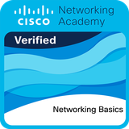

<!--
  The panels are generated SVGs, one set per GitHub theme (assets/dark and
  assets/light); <picture> shows the one that matches the reader's theme.
  To change their text or colors, edit scripts/build_assets.py (or
  scripts/ascii_art.txt) and run:
      python scripts/build_assets.py
  To see this file rendered before pushing:
      python scripts/preview.py
-->

<picture><source media="(prefers-color-scheme: dark)" srcset="./assets/dark/card.svg"/><source media="(prefers-color-scheme: light)" srcset="./assets/light/card.svg"/></picture>

I'm **Marce**, a cybersecurity student at **UTEC** in Lima. I got here by building things first: a Minecraft launcher, a GBA emulator page, an expense tracker that runs an AI model on the phone. Now I'm learning how software like that breaks, so I can protect it. Write-ups and CTF solutions will land here as I finish them.

 

<picture><source media="(prefers-color-scheme: dark)" srcset="./assets/dark/s-projects.svg"/><source media="(prefers-color-scheme: light)" srcset="./assets/light/s-projects.svg"/></picture>

<a href="https://github.com/byt3marc/PocketAnt"><picture><source media="(prefers-color-scheme: dark)" srcset="./assets/dark/p-pocketant.svg"/><source media="(prefers-color-scheme: light)" srcset="./assets/light/p-pocketant.svg"/></picture></a>

<a href="https://github.com/byt3marc/BM-MCL"><picture><source media="(prefers-color-scheme: dark)" srcset="./assets/dark/p-bm-mcl.svg"/><source media="(prefers-color-scheme: light)" srcset="./assets/light/p-bm-mcl.svg"/></picture></a>

<a href="https://github.com/byt3marc/MRC-Launcher"><picture><source media="(prefers-color-scheme: dark)" srcset="./assets/dark/p-mrc-launcher.svg"/><source media="(prefers-color-scheme: light)" srcset="./assets/light/p-mrc-launcher.svg"/></picture></a>

<a href="https://github.com/byt3marc/Emulator-GBA"><picture><source media="(prefers-color-scheme: dark)" srcset="./assets/dark/p-emulator-gba.svg"/><source media="(prefers-color-scheme: light)" srcset="./assets/light/p-emulator-gba.svg"/></picture></a>

**Try them in the browser:** [Emulator-GBA](https://byt3marc.github.io/Emulator-GBA/) · [MGL mini-games](https://byt3marc.github.io/MGL/)

### Everything else

| Project | What it is | Stack |
|:--|:--|:--|
| [MGL](https://github.com/byt3marc/MGL) | A static site of browser mini-games. Pick one and play. | `HTML` `CSS` `JS` |
| [ajedrez-mediocre](https://github.com/byt3marc/ajedrez-mediocre) | Chess in C++ with a class per piece, built for a UTEC course. | `C++` |
| [Lectura-de-numeros](https://github.com/byt3marc/Lectura-de-numeros) | Reads a number and writes it out in words. | `Python` |
| [Calculadora](https://github.com/byt3marc/Calculadora) | A calculator, and my first weekly project. Built to practise styling. | `HTML` `CSS` `JS` |
| [skills](https://github.com/byt3marc/skills) | Agent skills I wrote for myself, starting with password hygiene. | `Markdown` |
| brossard_plugin <kbd>private</kbd> | Minecraft server plugin. | `Java` |
| img-to-3d <kbd>private</kbd> | Turning images into 3D models. | `Python` |
| Proyecto_web <kbd>private</kbd> | Web project. | `CSS` |

Some repos stay private: they were paid work, or I don't consider them finished yet.

 

<picture><source media="(prefers-color-scheme: dark)" srcset="./assets/dark/s-certificates.svg"/><source media="(prefers-color-scheme: light)" srcset="./assets/light/s-certificates.svg"/></picture>

<!--
  HOW TO ADD A CERTIFICATE
  Copy a row and fill it in. Newest first. Save the badge image in
  assets/certs/ (about 160px wide is plenty). If there is no public
  verification link, write a dash in the last column.

  |  | Certificate name | Issuer | 2026-11 | [verify](https://link-to-credential) |
-->

| | Certificate | Issued by | Date | Credential |
|:-:|:--|:--|:--|:--|
|  | **Networking Basics** | Cisco | 2026-07 | [verify](https://www.credly.com/badges/39b5e326-4dcb-4af5-9a68-3d57b740f2f6/public_url) |
|  | **Introduction to Cybersecurity** | Cisco | 2026-03 | [verify](https://www.credly.com/badges/44c049e4-4f28-487f-80cb-aa01da7831e7/public_url) |

 

<picture><source media="(prefers-color-scheme: dark)" srcset="./assets/dark/s-contact.svg"/><source media="(prefers-color-scheme: light)" srcset="./assets/light/s-contact.svg"/></picture>

Email is the fastest way to reach me: **[marcelo.revilla@utec.edu.pe](mailto:marcelo.revilla@utec.edu.pe)**

<picture><source media="(prefers-color-scheme: dark)" srcset="./assets/dark/footer.svg"/><source media="(prefers-color-scheme: light)" srcset="./assets/light/footer.svg"/></picture>

